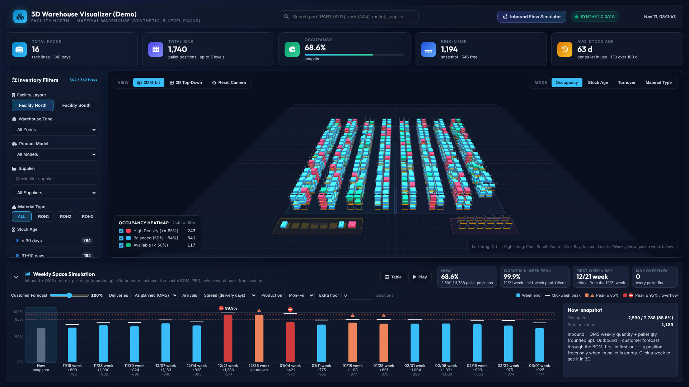
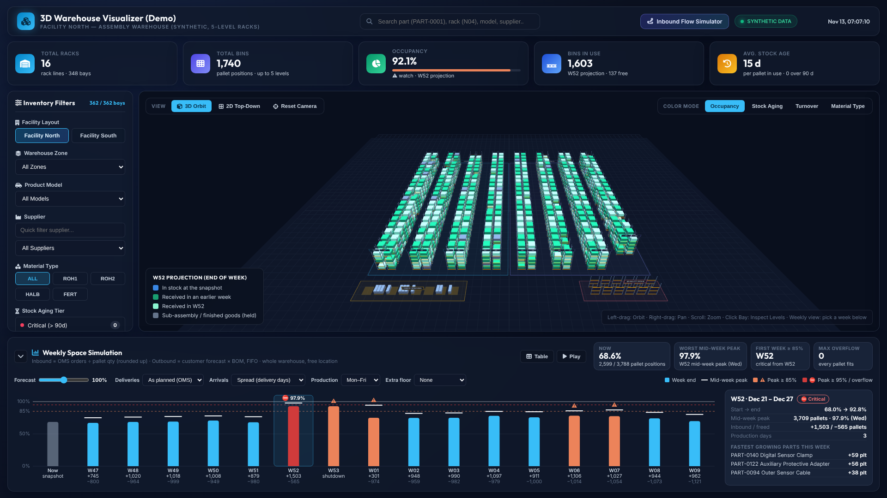
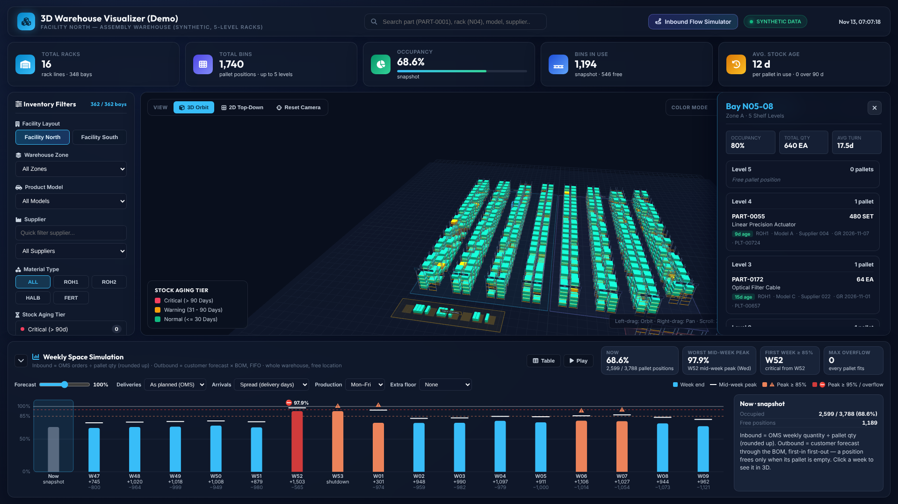
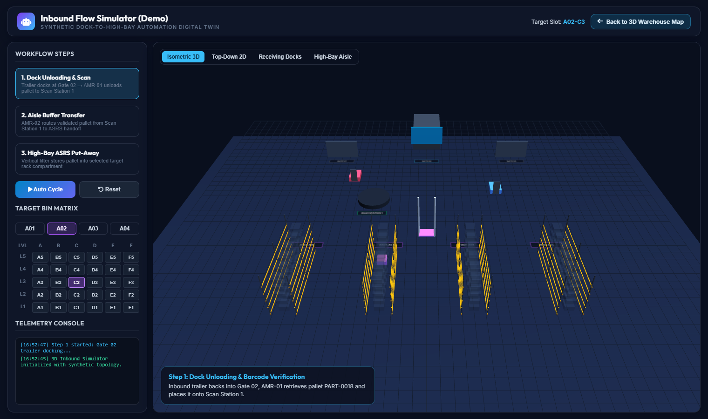

# 3D Warehouse Visualizer (Demo)

[](https://miaou360.github.io/3d-warehouse-visualizer/demo/index.html)
[](https://miaou360.github.io/3d-warehouse-visualizer/demo/simulation.html)
[](LICENSE)

An interactive WebGL digital-twin prototype for exploring rack-level warehouse inventory in 3D, **simulating week-by-week warehouse space (inbound orders vs. production consumption)**, and animating automated dock-to-rack inbound material flow — **playable directly in your browser with zero installation**.

- **Live 3D Warehouse Map**: https://miaou360.github.io/3d-warehouse-visualizer/demo/index.html
- **Live 3D Inbound Flow Simulator**: https://miaou360.github.io/3d-warehouse-visualizer/demo/simulation.html
- **Related Demo**: [Cross-Facility Material Pulling List](https://miaou360.github.io/sequencing-pulling-list/demo/index.html) ([Repo](https://github.com/Miaou360/sequencing-pulling-list)) — Multi-level BOM explosion, LOT-FIFO allocation, and cross-warehouse transit visibility.

> **100% Synthetic Data**: Every layout coordinate, zone, rack identifier, SKU, product model, supplier, lot number, BOM, forecast, and order quantity in this repository is deterministically generated from a fixed random seed (`tools/generate_fake_data.py`). The two facilities are invented 5-level pallet-rack buildings of a **material (raw-material) warehouse** at a realistic plant scale (3,788 pallet positions in total); no real facility floorplans or operational records are included. To try the tool on your own data, see [Use Your Own Data (Local Only)](#use-your-own-data-local-only) — that data never enters the repository.

[](https://miaou360.github.io/3d-warehouse-visualizer/demo/index.html)

## Key Features

- **Interactive 3D & 2D Warehouse Map (`demo/index.html`)**
  - Multi-level high-bay steel racks, floor staging lanes, and special inspection zones rendered with **Three.js (`r128`)**.
  - Smooth **GSAP** camera transitions between **3D Orbit** and **2D Top-Down** views.
  - **Pallet-unit KPI cards**: total racks (rack lines), total bins (pallet positions), occupancy, bins in use, and average stock age. They follow the 3D view — the snapshot (with the filters applied) or the projected week selected in the simulation dock.
  - **Light by design**: the data loads once with the page; filters, modes, and weeks only repaint. A whole facility is about **ten draw calls**: racks, beams, and pallets are three instanced meshes, all signs share one texture atlas, zone floors and lane pads are merged and opaque, and the click / hover targets live outside the scene graph. Frames are drawn only when something changes (camera, repaint, resize), with no shadow pass, no backdrop blur, and Lambert materials. The render profile follows the GPU: **high** (pixel ratio up to 1.5), **balanced** on integrated GPUs such as Intel UHD / Iris (pixel ratio 1 — about a third fewer pixels on 125 % displays), and **lite** without a GPU (remote desktops, VMs: no MSAA, no fog, lower resolution while the camera moves). If orbiting still runs below ~40 fps, the resolution steps down once and stays there. `?quality=lite|balanced|high` overrides the detection; `?perf=1` shows frame rate, draw calls, and resolution in the corner of the 3D view.
  - **Four Real-Time Heatmap Modes** (the **Mode** toolbar). The legend doubles as a filter: untick a category to hide those pallets in 3D and in the KPI cards (counts per category beside each row):
    - **Occupancy**: Highlights high-density (`>= 85%`), balanced (`50-84%`), and open (`< 50%`) bays.
    - **Stock Age**: Five age bands of each pallet since goods receipt — `≤ 30`, `31–90`, `91–180`, `181–365`, and `> 365` days — on a one-hue ramp where older stock is lighter and stands out.
    - **Turnover**: Contrasts fast-moving (`<= 15 days`), moderate (`16-38 days`), and slow-moving (`> 38 days`) stock (days of cover of the coming requirement).
    - **Material Type**: Raw-material types of the material warehouse (`ROH1`, `ROH2`, `ROH3`).
  - **Mixed, filterable stock**: free location over all racks, with high runners, moderate parts, slow movers, and dormant parts (received more than half a year ago, not reordered within the horizon). Every age band, turnover class, and material type appears in every rack line, so each filter has something to show.
  - **Multi-Faceted Search & Filtering**: Filter instantaneously by synthetic facility (`Facility North` / `Facility South`), warehouse zone (`Zone A/B/C`, `Staging`, `Special`), product model (`Model A`-`Model F`), supplier (`Supplier 001`-`Supplier 024`), material type (`ROH1`-`ROH3`), stock-age band, or free-text search.
  - **Slide-Over Bay Inspector**: Click any rack bay to inspect shelf-by-shelf (`Level 1`..`Level N`) box counts, quantities, goods-receipt dates, aging tags, and lot numbers.

- **Weekly Space Simulation (bottom dock of `demo/index.html`)**
  - Starts from the current snapshot (**68.6 %** of the rack pallet positions occupied) and simulates the next **16 weeks** day by day.
  - **Inbound** = the weekly order quantity per part from an order management system (OMS) ÷ pallet quantity, **rounded up** (full pallets + one partial pallet), spread over the part's delivery days.
  - **Outbound** = the weekly customer forecast per finished good, exploded through a **multi-level BOM** into child-part requirements and consumed evenly over the production days, **first-in first-out**. A pallet position frees only when its pallet is empty — a partial pallet still takes the whole position.
  - **Whole warehouse, free location**: all rack positions form one pool; new pallets take any free position.
  - **Mid-week peak**: deliveries land before production frees space, so every week shows its week-end occupancy (bar) **and** its highest daily occupancy (tick). The bar itself turns **orange** when the week's peak reaches `85 %` (`⚠ watch`) and **red** at `95 %` or when pallets overflow the racks (`⛔ critical / overflow`), so risky weeks stand out at a glance.
  - **Click a week** to project its end-of-week stock into the 3D racks: pallets still from the snapshot, received in earlier weeks, received in that week, and pallets that are not simulated (floor staging, quality hold). **Play** steps through the weeks.
  - **What-if controls**: customer forecast 70–130 %, deliveries one week early / late, arrivals spread vs. all on Monday, Mon–Sat production, and the number of extra floor positions you can lay out. Weeks are labelled by their Monday (`11/16 week`). KPIs (now, worst mid-week peak, first week ≥ 85 %, max overflow), hover tooltips, a table view, and a per-week detail panel (fastest-growing parts, parts that would run short).
  - The synthetic plan includes a short Christmas week, a shutdown week with a holiday build-ahead, and a new model launch, so the demo shows a critical peak in the `12/21 week` (W52), a critical restart week, and watch weeks while the launch parts arrive. Slow and dormant parts keep their positions for most of the horizon, as they do in a real material warehouse.

- **3D Inbound Flow Simulator (`demo/simulation.html`)**
  - Step-by-step and full auto-cycle animation of automated receiving:
    1. **Dock Unloading & Scan**: Inbound trailer docking, roll-up gate opening, AMR unloading, and laser scan verification.
    2. **Aisle Buffer Transfer**: Autonomous forklift routing from scan station to high-bay aisle handoff.
    3. **High-Bay ASRS Put-Away**: Vertical lifter storage into any user-selected rack/bay/level compartment via an interactive bin matrix.

[](https://miaou360.github.io/3d-warehouse-visualizer/demo/index.html)

[](https://miaou360.github.io/3d-warehouse-visualizer/demo/index.html)

[](https://miaou360.github.io/3d-warehouse-visualizer/demo/simulation.html)

## Repository Structure

```text
.
├── index.html              # Root redirect to demo/index.html for GitHub Pages
├── demo/
│   ├── index.html          # Main 3D warehouse inventory visualizer
│   ├── simulation.html     # 3D automated inbound logistics simulator
│   ├── app.js              # Dashboard state, KPI computation, and filters
│   ├── viewer3d.js         # Three.js WebGL scene (instanced racks & pallets), raycasting, and heatmaps
│   ├── sim_engine.js       # Weekly space simulation engine (pure functions; browser + Node)
│   ├── capacity.js         # Weekly simulation dock: chart, KPIs, what-if controls, 3D projection
│   ├── style.css           # Dark glassmorphic UI stylesheet
│   ├── data/               # Pre-generated synthetic JS bundles (+ manifest.js listing them)
│   └── vendor/             # Official Three.js r128, OrbitControls, TransformControls, GSAP
├── tools/
│   ├── generate_fake_data.py  # Deterministic synthetic layout + planning data generator (stdlib only)
│   └── build_from_exports.py  # Local-only: builds the bundles from your own CSV exports (git-ignored)
├── tests/                  # node --test (engine) and python -m unittest (tools)
├── backend/
│   ├── server.py           # Optional FastAPI server serving /demo and /api/inventory
│   └── requirements.txt
├── docs/
│   └── screenshots/        # Screenshots captured from synthetic demo data
├── LICENSE                 # MIT License
└── THIRD_PARTY_NOTICES.md  # Third-party library attributions & licenses
```

## Quick Start (Local)

### Option 1 — Zero-Install Static Demo (Recommended)

Serve the `demo/` directory with Python's built-in HTTP server (or open `demo/index.html` directly in a modern browser):

```bash
python -m http.server 8080 --directory demo
```

Then open `http://localhost:8080/index.html` in your browser.

### Option 2 — Regenerate Synthetic Data

Re-build `demo/data/facility_north.js`, `demo/data/facility_south.js`, and `demo/data/planning.js` with a deterministic seed:

```bash
python tools/generate_fake_data.py --seed 20261102
```

### Option 3 — Run with Optional FastAPI Backend

```bash
pip install -r backend/requirements.txt
uvicorn backend.server:app --reload --port 8000
```

Then visit `http://localhost:8000/demo/index.html` (API endpoints: `/api/health`, `/api/facilities`, `/api/inventory?facility=north`, `/api/planning`).

### Run the Tests

```bash
node --test                               # simulation engine (Node 18+, no dependencies)
python -m unittest discover -s tests      # data generator and CSV adapter (standard library only)
```

## Use Your Own Data (Local Only)

`tools/build_from_exports.py` turns your own CSV exports into the same JS bundles. Both the input folder (`data/real/`) and the output folder (`demo/data/local/`) are git-ignored, so real part numbers, quantities, and layouts stay on your machine.

| File | Columns | Meaning |
|------|---------|---------|
| `parts.csv` | `part_no, description, pallet_qty` (+ optional `material_type, supplier_code, supplier_name, uom, delivery_days, model`) | Purchased parts and their pallet quantity |
| `bom.csv` | `parent, child, qty` | Multi-level BOM, finished goods at the top |
| `forecast.csv` | `parent, week, qty` | Customer forecast per finished good |
| `oms.csv` | `part_no, week, qty` | Weekly order / delivery quantity per purchased part |
| `stock.csv` | `part_no, qty` (+ optional `pallets, gr_date, material_type`) | Current stock: one row per pallet, or per part with a pallet count; parts not in `parts.csv` are held in place (turnover shown as `999` days: no requirement) |
| `calendar.csv` *(optional)* | `week, prod_days, recv_days` | Weekdays `1`–`7` per week; empty = closed (default Mon–Fri) |
| `layout.csv` *(optional)* | `facility, bay_id, x, z, levels` (+ optional `rack_id, positions_per_level, zone, in_capacity, name`) | Your rack layout; without it the synthetic 5-level layout is used |

`week` is an ISO week (`2026-W47`) or any date inside the week.

```bash
python tools/build_from_exports.py --in-dir data/real --weeks 16
python -m http.server 8080 --directory demo
```

Then open `http://localhost:8080/index.html?data=local` — the badge in the header switches to **LOCAL DATA (PRIVATE)**.

## License

Original source code in this repository is licensed under the [MIT License](LICENSE). Bundled third-party libraries (`Three.js` and `GSAP`) are subject to their respective terms listed in [THIRD_PARTY_NOTICES.md](THIRD_PARTY_NOTICES.md).
