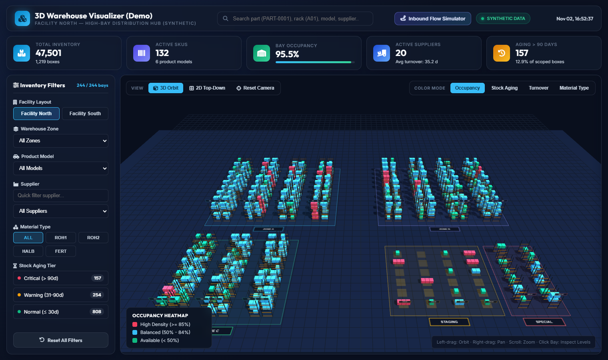
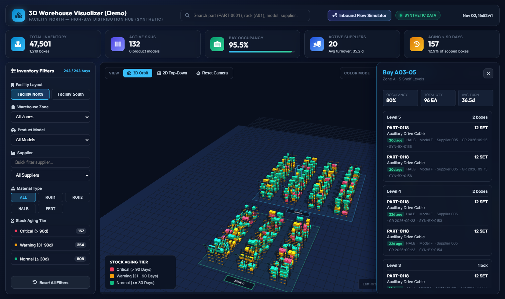
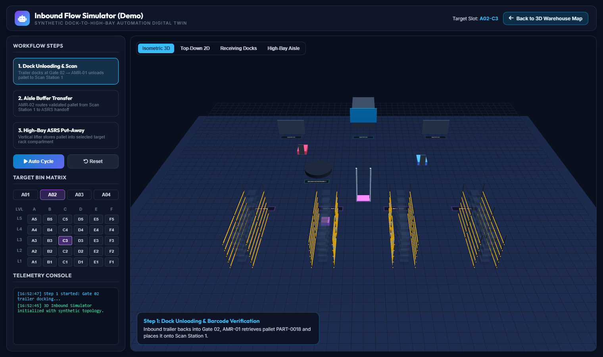

# 3D Warehouse Visualizer (Demo)

An interactive WebGL digital-twin prototype for exploring rack-level warehouse inventory in 3D and simulating automated dock-to-rack inbound material flow.

> **100% Synthetic Data**: Every layout coordinate, zone, rack identifier, SKU, product model, supplier, and lot number in this repository is deterministically generated from a fixed random seed (`tools/generate_fake_data.py`). No real facility floorplans or operational records are included.



## Key Features

- **Interactive 3D & 2D Warehouse Map (`demo/index.html`)**
  - Multi-level high-bay steel racks, floor staging lanes, and special inspection zones rendered with **Three.js (`r128`)**.
  - Smooth **GSAP** camera transitions between **3D Orbit** and **2D Top-Down** views.
  - **Four Real-Time Heatmap Modes**:
    - **Occupancy**: Highlights high-density (`>= 85%`), balanced (`50-84%`), and open (`< 50%`) bays.
    - **Stock Aging**: Flags critical (`> 90 days`), warning (`31-90 days`), and normal (`<= 30 days`) inventory tiers.
    - **Turnover**: Contrasts fast-moving (`<= 15 days`), moderate (`16-38 days`), and slow-moving (`> 38 days`) stock.
    - **Material Type**: Groups stock by generic material category (`ROH1`, `ROH2`, `HALB`, `FERT`).
  - **Multi-Faceted Search & Filtering**: Filter instantaneously by synthetic facility (`Facility North` / `Facility South`), warehouse zone (`Zone A/B/C`, `Staging`, `Special`), product model (`Model A`-`Model F`), supplier (`Supplier 001`-`Supplier 020`), material type, aging tier, or free-text search.
  - **Slide-Over Bay Inspector**: Click any rack bay to inspect shelf-by-shelf (`Level 1`..`Level N`) box counts, quantities, goods-receipt dates, aging tags, and lot numbers.

- **3D Inbound Flow Simulator (`demo/simulation.html`)**
  - Step-by-step and full auto-cycle animation of automated receiving:
    1. **Dock Unloading & Scan**: Inbound trailer docking, roll-up gate opening, AMR unloading, and laser scan verification.
    2. **Aisle Buffer Transfer**: Autonomous forklift routing from scan station to high-bay aisle handoff.
    3. **High-Bay ASRS Put-Away**: Vertical lifter storage into any user-selected rack/bay/level compartment via an interactive bin matrix.





## Repository Structure

```text
.
├── demo/
│   ├── index.html          # Main 3D warehouse inventory visualizer
│   ├── simulation.html     # 3D automated inbound logistics simulator
│   ├── app.js              # Dashboard state, KPI computation, and filters
│   ├── viewer3d.js         # Three.js WebGL scene, raycasting, and heatmaps
│   ├── style.css           # Dark glassmorphic UI stylesheet
│   ├── data/               # Pre-generated synthetic JS bundles
│   └── vendor/             # Official Three.js r128, OrbitControls, TransformControls, GSAP
├── tools/
│   └── generate_fake_data.py  # Deterministic synthetic dataset generator (stdlib only)
├── backend/
│   ├── server.py           # Optional FastAPI server serving /demo and /api/inventory
│   └── requirements.txt
├── docs/
│   └── screenshots/        # Screenshots captured from synthetic demo data
├── LICENSE                 # MIT License
└── THIRD_PARTY_NOTICES.md  # Third-party library attributions & licenses
```

## Quick Start

### Option 1 — Zero-Install Static Demo (Recommended)

Serve the `demo/` directory with Python's built-in HTTP server (or open `demo/index.html` directly in a modern browser):

```bash
python -m http.server 8080 --directory demo
```

Then open `http://localhost:8080/index.html` in your browser.

### Option 2 — Regenerate Synthetic Data

Re-build `demo/data/facility_north.js` and `demo/data/facility_south.js` with a deterministic seed:

```bash
python tools/generate_fake_data.py --seed 20261102
```

### Option 3 — Run with Optional FastAPI Backend

```bash
pip install -r backend/requirements.txt
uvicorn backend.server:app --reload --port 8000
```

Then visit `http://localhost:8000/demo/index.html` (API endpoints: `/api/health`, `/api/facilities`, `/api/inventory?facility=north`).

## License

Original source code in this repository is licensed under the [MIT License](LICENSE). Bundled third-party libraries (`Three.js` and `GSAP`) are subject to their respective terms listed in [THIRD_PARTY_NOTICES.md](THIRD_PARTY_NOTICES.md).

